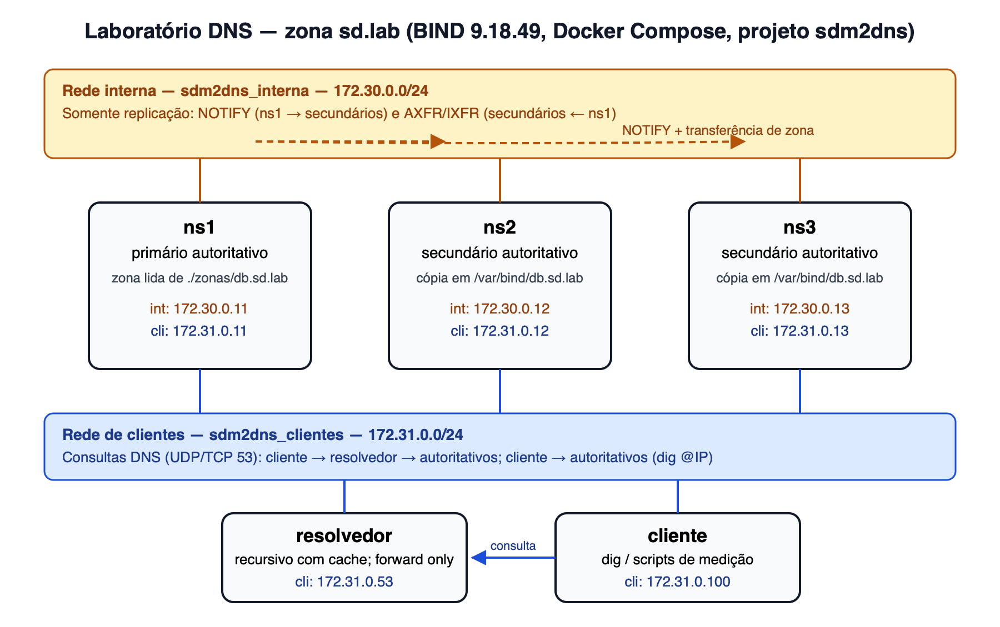

# Trabalho M2 — Registro de progresso (aula de 21/10/2026)

**Disciplina:** Sistemas Distribuídos — UNIVALI · **Prof.:** Ramices dos Santos Silva
**Equipe:** _[nomes dos integrantes]_
**Tema:** T1 — Sistema de nomes distribuído (DNS), sistema de referência BIND 9
**Ênfase:** D — Descoberta de serviços (cloud native), com CoreDNS (E9)

## Objetivo da etapa
Montar e validar o laboratório-base do roteiro (seção 5.2) e executar o experimento E1
(subida e topologia) com evidências reais.

## Ambiente
- Host: MacBook Air M3, 16 GB, macOS 26.4.1; Docker Desktop 29.4.3, Compose v5.1.3.
- Imagem própria `sd-bind` (39,1 MB): Alpine 3.20.10 + BIND 9.18.49 ESV.
- 5 contêineres: `ns1` (primário), `ns2` e `ns3` (secundários), `resolvedor` (recursivo com cache), `cliente`.
- 2 redes: interna 172.30.0.0/24 (replicação) e clientes 172.31.0.0/24 (consultas).
- Zona `sd.lab`, serial 2026101401, refresh 30 s, retry 10 s, expire 300 s, TTL negativo 20 s, TTL 60 s.
- Repositório Git com Dockerfile, docker-compose.yml, named.conf de cada servidor, zona, scripts e evidências.

## Atividades realizadas
1. Leitura do roteiro (seções 1–5, 10 e 11) e levantamento dos requisitos do tema DNS.
2. Escrita dos arquivos completos a partir dos trechos do roteiro, validados com `named-checkconf`,
   `named-checkzone` e `docker compose config` antes da subida.
3. Ajustes documentados: chave `rndc` gerada na imagem (sem ela `rndc reload` falha); NOTIFY só
   pela rede interna (`notify explicit`), pré-requisito para o experimento de partição (E6).
4. **Previsão do E1 registrada antes da execução** (commit no Git anterior ao resultado).
5. Execução do E1 com script que grava as evidências (`scripts/e1.sh`).
6. Diagrama próprio da topologia.

## Principais comandos
```bash
docker compose up -d
docker compose logs ns2 | grep -i transfer
for s in 11 12 13; do docker exec cliente dig @172.31.0.$s sd.lab SOA +short; done
docker exec ns1 rndc zonestatus sd.lab
```

## Resultados do E1 (observados)
- Os 5 contêineres ficaram em execução, com os endereços previstos no roteiro.
- ns2 e ns3 receberam a zona do primário por **AXFR** (9 registros, 224 bytes) pelo endereço
  **interno** 172.30.0.11; o ns2 foi disparado pelo NOTIFY, e o ns3 pela própria verificação inicial.
- Os três autoritativos respondem o **mesmo serial 2026101401** com flag `aa`; o resolvedor
  responde `app.sd.lab = 10.0.0.1` com flag `ra` e sem `aa`.
- `rndc` funcional nos 4 servidores; ~26 MiB por servidor BIND (≈ 104 MiB no total).



## Pesquisa
- Rascunho das respostas Q1–Q14 e S1 já iniciado pela equipe; S2–S4 pendentes.
- Pontos que serão revisados com base nos experimentos: comunicação entre servidores (primário-secundário,
  não P2P), resolução hierárquica (raiz → TLD → autoritativo), serial do SOA como relógio lógico (RFC 1982),
  AXFR/IXFR/NOTIFY (RFC 1995/1996), cache negativo (RFC 2308) e a posição diante de partições (sustentada pelo E6).
- Fontes primárias: Mockapetris e Dunlap (1988); RFCs 1034, 1035, 1982, 1995, 1996, 2136, 2308;
  BIND 9 ARM; documentação do CoreDNS (ênfase D).

## Estrutura do relatório (seção 10 do roteiro)
Seções previstas: (1) Identificação; (2) Resumo; (3) Fundamentação (artigo seminal, arquitetura com diagrama próprio);
(4) Ambiente e reprodutibilidade (já levantado acima); (5) Experimentos E1–E9 (E1 concluído); (6) Respostas Q1–Q14;
(7) Respostas S1–S4; (8) Quadro-síntese; (9) Limitações e ameaças à validade; (10) Papel de cada integrante;
(11) Declaração de uso de IA generativa; (12) Referências (ABNT).

## Plano da apresentação (seção 11 do roteiro, 10 min + 5 min de arguição)

| Bloco | Conteúdo | Tempo | Responsável |
|---|---|---|---|
| 1 | Problema, uso real e artigo seminal | 1 min | _[a definir]_ |
| 2 | Arquitetura e papéis (diagrama acima) | 2 min | _[a definir]_ |
| 3 | Demonstração: E2, E3, E5/E6, E7 | 4 min | _[a definir]_ |
| 4 | Ênfase D (E9): descoberta de serviços com CoreDNS | 2 min | _[a definir]_ |
| 5 | Quadro-síntese | 1 min | _[a definir]_ |

O laboratório sobe em segundos e usa ~104 MiB, o que viabiliza a demonstração ao vivo com o cluster
já em execução; será gravado um vídeo de contingência.

## Próximos passos (ainda não executados)
- E2: caminho de leitura (resolvedor x autoritativo, query log) e de escrita (NOTIFY + transferência).
- E3: tempo de propagação com e sem NOTIFY (5 repetições cada, média e desvio padrão, script com relógio monotônico).
- E4: cache, TTL e cache negativo. E5–E7: falha, partição de ns3 só na rede interna, recuperação.
- E8: serial como ordenação (publicação com serial menor; RFC 1982).
- E9 (ênfase D): CoreDNS com registro e remoção de instâncias, TTL baixo x alto, carga e tempo até o cliente abandonar a instância removida.
- Revisão das respostas Q1–Q14 e S1–S4 com base nas evidências.
